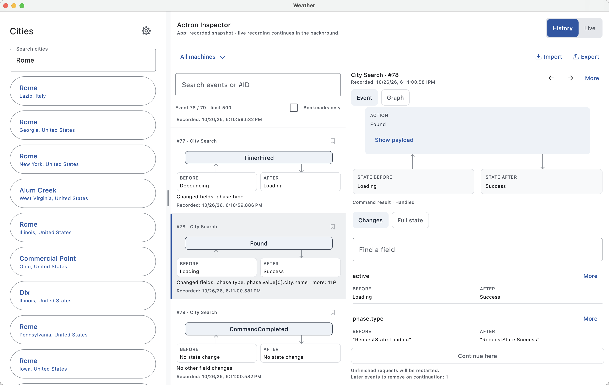
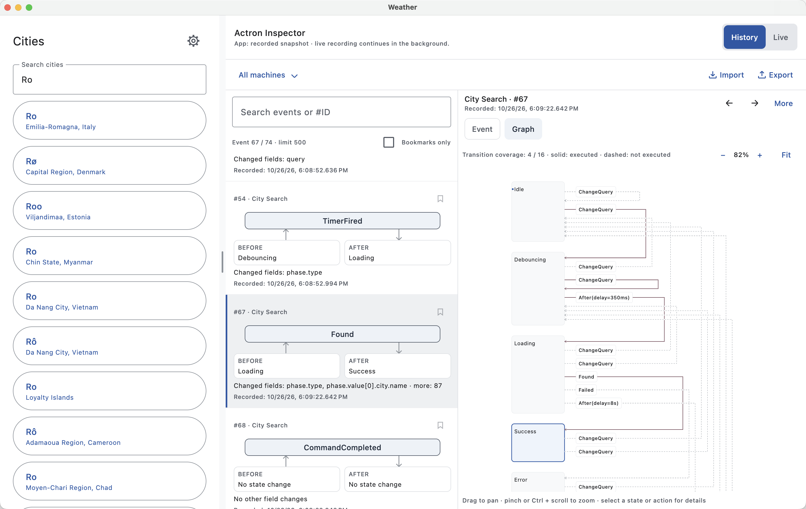
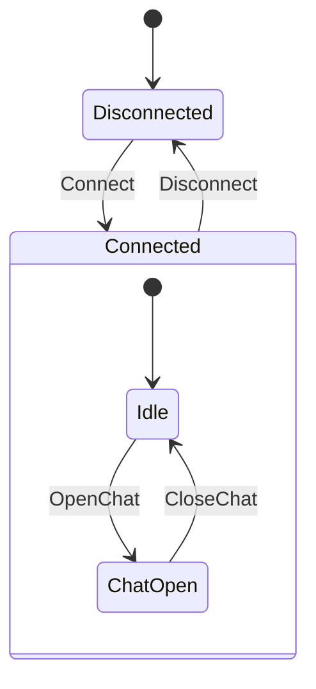
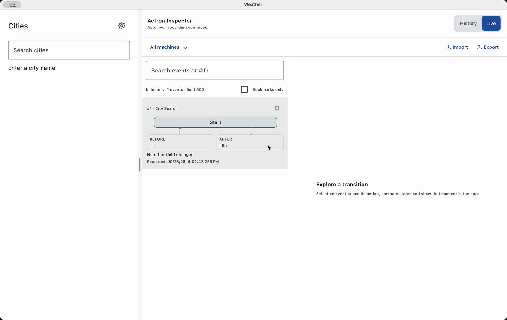

# Actron


**MVI with an explicit model of what can happen next.**

Actron is a Kotlin Multiplatform library for features whose behavior includes requests,
cancellation, retries, timers, and independent processes running at the same time.

The screen API is **our typed StateChart machine + `MachineStore`**. Send an action from
any thread. The runtime queues inputs, makes one pure decision at a time, commits the next
state in one place, and executes commands afterward. Command handlers call your use cases
and return actions; they never write state. Compose observes state on the UI dispatcher.

## See the state behind the screen

The [Weather example](examples/weather/README.md) puts the application and Actron Inspector
side by side. Enable **Debug panel** in Settings before searching for **Rome, Italy**.



The application is on the left, the recorded event timeline in the middle, and the selected
event's details on the right. Here, **Action: Found** changes **State Before: Loading** into
**State After: Success**, and the application displays the recorded city results.

- **Inspect a decision:** expand **Show payload** to read the action's data. **Changes**
  compares field values before and after; **Full state** shows the complete state, and
  **Find a field** narrows the fields you inspect.
- **Find an event:** filter by machine, search events or `#ID`, bookmark useful moments,
  and show only bookmarked events. Each entry includes its recording timestamp.
- **Move through the session:** the arrow buttons step backward and forward through visible
  events and update the application preview. **Live** returns to the running application.
  **Continue here** can start execution from a compatible selected checkpoint.
- **Share a recording:** **Export** saves the session for inspection; **Import** opens a
  view-only recording without starting its commands or network requests.



Switch to **Graph** to inspect the same machine as a statechart. This screenshot shows an
earlier **Ro** query: **Success** is active, and the graph includes the **350 ms debounce**
and **8 s timeout** transitions. Solid lines mark executed transitions; dashed lines mark
transitions not executed in the recorded coverage. Pan, zoom or **Fit** the diagram, and
select a state or transition for details. The graph comes from the machine definition used
by the executor.

These are reusable components from
[`actron-timetravel-compose`](actron-timetravel-compose/README.md). Weather supplies its
application snapshots and navigation restoration. See [Time Travel below](#4-time-travel-from-a-real-saved-run)
for the inspector in motion.

## What does Actron add to MVI?

MVI gives a feature a one-way flow: **action → state → UI**. Actron also describes the allowed
behavior as a graph that the executor, diagrams, tests, and recordings share.

| Feature problem | What you declare | What Actron handles |
|---|---|---|
| A request must stop when its screen phase ends | A command in `Loading.onEnter` | Activation-scoped cancellation and rejection of stale responses |
| Typing should debounce; loading should time out | `after<Target>(duration)` inside the owning state | Timer identity, cancellation on exit, and explicit time during replay |
| Current weather and forecast load independently | Typed parallel regions | Separate lifetimes with one ordered stream of state decisions |
| Several phases share behavior | Nested states, parent transitions, history and final states | Transition selection, exit/entry ordering, and composite completion |
| The UI and debug graph disagree about the phase | One sealed state value bound with `typedStateMachine` | Derived graph IDs and invariant checks; no handwritten `GuardKey`, `EffectKey`, or action casts |
| A bug depends on a particular sequence of responses | Record machine inputs, decisions and checkpoints | Bounded recording, replay verification, and inspection of Before / Action / After |
| A parent owns a child workflow | Typed `invoke` + `InvokedMachineStore` | One atomic snapshot, scoped command/timer execution and restoration of both sides |
| A pending operation must not be blindly repeated | A command recovery strategy | Restart, reconciliation or cancellable waiting for an application decision |
| You want to continue from a past point | Restore a compatible executor checkpoint | Restartable commands and remaining timer delays; the host restores navigation |

This is a modeling choice, not a claim that other MVI libraries lack debugging or safety.
[MVIKotlin](https://github.com/arkivanov/MVIKotlin) emphasizes a single source of state and
includes logging and Time Travel. [Orbit](https://github.com/orbit-mvi/orbit-mvi) emphasizes
concise coroutine-based intents, reductions, and ViewModel integration. Actron's focus is
**an executable statechart with pure decisions and explicit command/timer lifetimes**.
Use it when those lifetimes and transitions deserve to be visible in the feature definition.
A small form or counter can use a single-state chart.

Actron does not provide navigation, repositories, or dependency injection. The weather example
uses Decompose for component lifetimes and navigation. `actron-core` is the internal execution
engine. Application reducers use our StateChart implementation; handwritten replacement
reducers and the former standalone Store DSL are not supported.
Library and example sources follow a CI-enforced [null-free policy](doc/guides/absence-policy.md),
including compiler-resolved types; absence is modeled as explicit domain states.

[Typed MVI quick start](#1-a-store-for-a-counter) · [Threading and commands](doc/guides/machine-mvi.md) ·
[Weather demo](examples/weather/README.md) · [Installation](#installation) ·
[Null-free API policy](doc/guides/absence-policy.md)

### Determinism you can verify

On the pure Machine path, the same starting snapshot and ordered inputs — including explicit
time — produce the same decisions when the machine definition and pure rules are unchanged.
Network responses enter as inputs; commands leave as data. Replay checks recorded decisions
without running the network calls again.

That gives a bug report a concrete next step: **open the recording, find the decision, try an
alternative.** Deterministic replay requires the pure Machine path and compatible definitions
and codecs. Replay, branching and inspector APIs are part of the supported API.

### Start small. Make complexity explicit.

A counter can use a single state. A loading screen needs clear phases. A feature with nested or
parallel lifetimes can add hierarchy and parallel regions. Add recording and Time Travel when you need them;
choose the modules that fit your feature.

The name carries the idea: **Act** for the actions that drive behavior, **-tron** for the
engine that gives them structure.

## Start here

| You want to… | Start with… |
|---|---|
| Understand typed actions, state and a Store | [The counter below](#1-a-store-for-a-counter), then [the MVI contract](doc/guides/machine-mvi.md) |
| Model Loading → Content or Error | [Typed states](actron-statechart/README.md#state-types-shared-by-graph-ui-and-recordings) |
| Describe nested/parallel phases and draw their transitions | [actron-statechart](actron-statechart/README.md) |
| Keep I/O separate from decisions and replay them | [A pure Machine below](#3-a-machine-makes-decisions-io-runs-afterward) |
| Connect a Store to Compose | [actron-compose](actron-compose/README.md) |
| Reproduce a bug from a saved run | [Weather recording and continuation](examples/weather/README.md#session-history-and-replay) |
| Explore MVI, a live API and an embeddable debug panel | [The Multiplatform weather demo](examples/weather/README.md) |
| Generate tests from a graph and inspect a late-response scenario | [Weather's generated tests and recordings](examples/weather/README.md#automatically-generated-tests-and-recordings) |

## 1. A Store for a counter

The typed DSL declares transitions and handlers inside their state. Here one state owns
context-only updates; no separate node IDs or reducer registration strings are needed.

```kotlin
import actron.core.Action
import actron.statechart.machine.*
import kotlinx.coroutines.CoroutineScope
import kotlinx.coroutines.Dispatchers

data class CounterState(val count: Int = 0)
sealed interface CounterAction : Action {
    data object Increment : CounterAction
    data object Decrement : CounterAction
}

val counterMachine = typedStateMachine<CounterState, CounterAction, Nothing, Nothing>(
    DefinitionId("counter"), DefinitionVersion("1"), CounterState(),
) {
    state<CounterState> {
        internal<CounterAction.Increment> { context, _ -> context.copy(count = context.count + 1) }
        internal<CounterAction.Decrement> { context, _ -> context.copy(count = (context.count - 1).coerceAtLeast(0)) }
    }
}

fun counterStore(scope: CoroutineScope) = MachineStore(
    machine = counterMachine,
    context = CounterState(),
    handler = CommandHandler<Nothing, CounterAction> { _, _ -> },
    scope = scope,
    coroutineContext = Dispatchers.Main, // Choose where decisions and commits run.
)
```

Create the Store once for its owner's lifetime. `store.dispatch(CounterAction.Increment)`
queues an action and starts a lazy store; it does not wait for the new state. Collect
`store.state` and render `snapshot.context.count`. Call `store.close()` when the owner is
destroyed. `Nothing` means this machine has no commands or events.

For Compose, `val snapshot by store.state.collectAsUiState()` from `actron-compose` collects
on Main even if the machine processes on a background dispatcher. The platform must provide
`Dispatchers.Main` and create its composition on the UI thread. This is independent of
`scope`, which supplies the command execution context and lifetime.

The queue preserves acceptance order per machine. A single-thread dispatcher or Main also
pins processing to one physical thread; Default/IO pools still process inputs sequentially,
but may use different threads. See the [full threading contract](doc/guides/machine-mvi.md).

The Store engine has no public construction DSL. For retained components, use
[`retainedMachine`](actron-decompose/README.md).

## 2. Which kind of state machine do you need?

A **state machine** says which transitions are allowed. A **statechart** extends that idea
with hierarchy, parallel regions and history. Choose the smallest model that explains your
feature's behaviour.

| Shape | Example | Actron representation |
|---|---|---|
| One state with changing data | A counter or an editable form | A data class and `internal<Action>` updates |
| Flat, mutually exclusive phases | Idle → Loading → Content or Error | Sealed values with `typedStateMachine` |
| Hierarchical phases | Connected contains Idle and ChatOpen | `compound<Parent>`; one active child at a time |
| Parallel phases | Connection status and upload status evolve independently | `parallelStateMachine` regions, or nested `parallel<Parent>` |
| Return to a previous substate | Resume an interrupted multi-step editor | `history()` / `history(deep = true)` and `onHistory<Action, Parent>()` |
| Timed transitions | Debounce a query or leave Loading after a timeout | `after<Target>(duration)` inside a state |

For example, ChatOpen and Idle share the Connected lifetime:



Moving Idle → ChatOpen keeps Connected active. Disconnect exits the active child and then
Connected. In parallel regions, Connection.Online and Upload.Sending can both be active; they
are not competing choices in one sealed state.

**Keep data as data.** A query string, selected contacts, a counter and scroll position belong
in state/context fields. Loading, Editing and WaitingForConfirmation are useful nodes because
they change which actions, commands or lifetimes are allowed. You do not need a node for every
possible query or count.

Internally, `StateId` identifies a node and `StateConfiguration` tracks active nodes. The typed
DSL derives these graph identities from your state types and binds them to the values the UI
reads. Shared data can live in a separate context; when the typed state is the complete model,
the short overload supplies the binding. The runtime exposes both graph and data in a snapshot.

## 3. A Machine makes decisions; I/O runs afterward

A StateChart `Machine` defines behavior; `MachineStore` executes it and exposes `MachineSnapshot<C>`.

A pure `Machine` takes a snapshot and an input and returns a `Decision`. Commands, timer
changes and effects are data in that decision. `MachineStore` commits it, then a
`CommandHandler` performs I/O and sends results back as new inputs.

The counter above can also run without coroutines:

```kotlin
val started = counterMachine.decide(
    counterMachine.initialSnapshot(CounterState()), MachineInput.Start(MachineTime.Zero),
)
val incremented = counterMachine.decide(
    started.snapshot, MachineInput.Dispatch(CounterAction.Increment, MachineTime.Zero),
)
// incremented.snapshot.context.count == 1; no Store or I/O was started.
```

For a request, entering Loading registers a command. A `commandHandler(onFailure = ...)`
executes the use case and returns a success or failure action. `commandHandlers { handle<T> { ... } }`
routes several command types without casts or manual result emission. The runtime owns the
queue, cancellation and dispatch of those results. See the [request example](doc/guides/machine-mvi.md#request-handlers).

The typed DSL supports [sealed phases](actron-statechart/README.md#state-types-shared-by-graph-ui-and-recordings),
[parallel regions](actron-statechart/README.md#typed-parallel-regions),
[hierarchy, history and completion](actron-statechart/README.md#typed-hierarchy-history-and-completion),
and [child invocation](actron-statechart/README.md#state-local-typed-invocation).
Explicit-ID definitions remain available for lower-level tools and existing users.

## 4. Time Travel from a real saved run

The [Weather application](examples/weather/README.md) demonstrates recording, inspection,
checkpoint continuation and imported view-only recordings in the same two-screen application.



Search **Rome**, open **Rome, Italy**, then use the inspector's arrow buttons to move
backward and forward through the recorded events. Watch the query, city results, weather
and loading states change together with **Action**, **State Before** and **State After**.
Selecting history renders saved application frames without making those network requests
again; live recording continues in the background. **Live** returns to the running session.

Finally, press **Continue here** at the earlier **Ro** query. The application returns to
**Live**, restarts the unfinished search and displays results for that restored query. You
can resume execution from any compatible checkpoint: the host restores navigation and
executors, completed reads stay completed, unfinished read requests restart, and timers
retain their remaining delay. Continuing replaces the running session and removes later
history; new events extend the history from the selected point.

```sh
./gradlew :weather:desktopApp:run
```

## Skills for your AI

Reusable agent instructions live in [skills/](skills/README.md): modeling with the typed DSL,
virtual-time testing and coverage, and extracting graph/recording diagnostics. The skills
include module routing and check the current API version before proposing code.

## Modules

Every library module has its own README with setup, examples and its contract.

| Module | Purpose |
|---|---|
| [actron-core](actron-core/README.md) | Internal execution engine and shared action/event/lifetime contracts |
| [actron-decompose](actron-decompose/README.md) | One-call retained machine setup and lifecycle-bound observation for Decompose |
| [actron-compose](actron-compose/README.md) | `ViewStore`, state rendering, derived UI values and transient event collection |
| [actron-message](actron-message/README.md) | Transient messages from command handlers and runtime subscriptions |
| [actron-logging](actron-logging/README.md) | Store logging and structured journal output |
| [actron-test](actron-test/README.md) | Await processing, record states/events and diagnose handlers |
| [actron-statechart](actron-statechart/README.md) | Declarative model, validation, diagrams, chart runtime and pure Machines |
| [actron-statechart-compose](actron-statechart-compose/README.md) | Retained Machine effects delivered to Compose |
| [actron-statechart-test](actron-statechart-test/README.md) | Scripted/generated scenarios, data and rules DSL, virtual time and coverage |
| [actron-timetravel-test](actron-timetravel-test/README.md) | Optional export of generated test traces as view-only recordings |
| [actron-diagnostics](actron-diagnostics/README.md) | KMP causal traces for decisions, commands, timers and bridge effects |
| [actron-diagnostics-sdk](actron-diagnostics-sdk/README.md) | Optional OpenTelemetry and Sentry adapters for JVM/Android |
| [actron-diagnostics-crashlytics](actron-diagnostics-crashlytics/README.md) | Optional Android Crashlytics adapter |
| [actron-observability](actron-observability/README.md) | Ordered, bounded diagnostic journal and file storage |
| [actron-persistence](actron-persistence/README.md) | Current checkpoint codecs and restoration without debug tooling |
| [actron-timetravel](actron-timetravel/README.md) | Recording, codecs, checkpoints, replay and isolated branches |
| [actron-timetravel-compose](actron-timetravel-compose/README.md) | Inspector UI and group replay/experiment controls |
| [weather](examples/weather/README.md) | Compose Multiplatform MVI weather app with a live API and resizable debug panel; not a published library |

## Installation

Actron's configured coordinates are **`io.github.roman-n1:<module>:5.0.0-alpha.1`**.
GitHub releases provide source archives and may include an IDE plugin ZIP. Maven Central
publication is separate; for development, use a local checkout/composite build:

```kotlin
// settings.gradle.kts in your application
includeBuild("../actron") // path to this repository; its root name is Actron
```

```kotlin
// Kotlin Multiplatform build.gradle.kts in your application
kotlin {
    sourceSets {
        commonMain.dependencies {
            implementation("io.github.roman-n1:actron-statechart:5.0.0-alpha.1")
            // For Decompose: implementation("io.github.roman-n1:actron-decompose:5.0.0-alpha.1")
        }
    }
}
```

The publishing convention sets the included projects' group/version, so Gradle substitutes
the matching coordinates. Add only the modules you need; no Actron opt-in is required.
Keep all Actron modules on the same version. Actron uses `actron.*` packages and requires
recompiling consumers that previously imported `koma.*`; it is not a binary replacement.
For an Android-only build, the same dependency line belongs in `dependencies { … }`.

## What differs from the original project?

Actron was previously named Koma in this fork, based on upstream
[koma-kt/koma](https://github.com/koma-kt/koma) **4.0.0**. The source repository is currently
[roman-n1/actron](https://github.com/roman-n1/actron). It uses its own declarative StateChart model, pure decision machines, structured recording
and Time Travel. The original standalone Store DSL has been removed from the application API.
See [Migrating from Koma](doc/guides/migrating-from-koma.md) for the breaking rename.

Actron evolves independently. Source, binary and runtime interoperability with upstream
Koma 4.0.0 are unsupported; consumers must migrate to Actron and recompile. Compatibility
with Koma does not constrain Actron's API or releases.

The comparison is with the recorded **upstream base 4.0.0**, not a claim about future upstream
releases. Compose helpers, messaging, logging and runtime test support remain.

| Area | Upstream base 4.0.0 | This fork adds |
|---|---|---|
| State management | State-specific Kotlin Store handlers | Statechart nodes/transitions as inspectable data |
| State structure | Ordinary Store states | Hierarchy, parallel regions, history and chart timers |
| I/O and decisions | Coroutine work in Store handlers | Pure Machine decisions and explicit command/executor checkpoints |
| Diagnostics | Plugin observation and logging | Ordered structured journal, bounded retention and file readers |
| Debugging | Inspect/test Store behaviour | Single/group replay, divergence details and isolated experiments |
| UI/test integration | Core Compose and test helpers | Retained effect mailbox, virtual Machine test driver and inspector |
| Runtime/build assurance | Original runtime and build | Documented race/error fixes, API dumps, debug dependency checks and six CI targets |

The chart/Machine model, Store adapters, external sources, replay, inspector and test helpers
are supported API. Before the first release, obsolete aliases and previous-format readers
are removed; see the [unreleased API baseline](doc/internal/adr/2026-10-26-unreleased-api-baseline.md).
The supported subset includes eventless/completion transitions, final states, internal
transitions and cancellable invocation. Device measurements and messenger integration
remain separate work. The [divergence inventory](doc/internal/design/2026-09-28-statechart-roadmap.md#divergence-inventory-vs-upstream-400)
records the individual changes and their route back upstream.

## Contributing and deeper reading

- [Kotlin code style](doc/guides/code-style.md): `./gradlew ktlintCheck` to verify, `./scripts/format-kotlin.sh` to format the entire repository.

- [Machine MVI guide](doc/guides/machine-mvi.md): decisions, commands, lifetime and execution policies.
- [Absence policy](doc/guides/absence-policy.md): migration away from null and optional containers, API changes and the CI guard.
- [Device resource budgets](verification/resource-soak/README.md): required Android/iOS soak runs, resource cleanup, memory plateau and commit latency reports.
- [Internal documentation](doc/internal/README.md): architecture, decisions, review evidence and roadmap.
- [IntelliJ plugin](tooling/intellij-plugin/README.md): K2 gutter, model Find Usages and diagram navigation.
- [Build conventions](build-logic/README.md): coordinates, publishing and project setup.
- Validation: `./gradlew jvmTest apiCheck checkDebugGraph`; the CI also tests Android, iOS, JS and Wasm.
- Published artifacts: `scripts/verify-published-consumer.sh jvm` builds an
  [independent Maven consumer](verification/published-consumer/README.md); CI also compiles its
  Android, JS, Wasm and iOS variants.

Published-consumer checks reject upstream Koma dependencies in Actron's dependency graphs.
