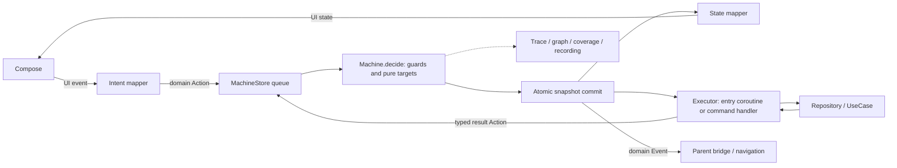

# Actron MVI and State Machine

Actron owns the complete MVI execution cycle. The machine is its pure reducer and source of
allowed transitions; there is no independently configurable reducer that can override it.
See the [API audit](api-audit.md), [migration](migration-guide.md) and
[execution guide](../guides/machine-mvi.md) for signatures and dispatcher contracts.

| Entity | Creator / owner | Caller / reader | Lifetime and result |
|---|---|---|---|
| Domain state/action | Feature author | MachineStore / pure machine | Immutable business data; sole committed snapshot |
| UI state/event | Feature presentation | Compose / intent mapper | Derived display data, never a second mutable store |
| Machine / reducer | Feature DSL | MachineStore; pure tests/replay | Definition shared by runtime, graph and coverage |
| Store | Component assembly; InstanceKeeper | Presenter, parent inputs, runtime | Ordered input queue, state/effect publication; closed with owner |
| Executor | Store runtime | Calls repository; sends typed action | Activation-owned entry or command; cancelled on exit/close |
| Result | Feature author, when useful | Same machine transition path | Usually another variant of domain Action |
| Event / UI effect | Pure machine decision | Lifecycle-bound parent/UI observer | Post-commit external notification; delivery policy matters |
| Repository | Application DI | Executor | Ordinary dependency, independent of Actron |
| Restorable root | Host assembly | Debug history / host renderer | Owns replacement generations, closes with parent lifecycle |

## Ordering and failure

A Refresh action is queued and decided against the current snapshot. The Loading transition is
committed before its entry executes. Repository IO runs outside the decision lock. Success/failure
returns as an action and is checked by the same state's handlers/guards; it cannot assign state.
The queue orders accepted inputs within one store, not globally across all stores. A rejected or
ignored transition does not partially update state; explained decisions expose missing handlers,
guard outcomes and failures to diagnostics.

Weather uses activation-scoped latest-wins: a Refresh while Loading transitions into a fresh
Loading activation. Exiting the prior activation cancels its entry; late results cannot update the
replacement activation. Search additionally carries query revisions and checks them in result guards.
Independent weather/current/hourly/advice machines run independently, routed by MachineGroup.
CancellationException is rethrown; expected repository failures become typed failure actions and
Error states. Unexpected runtime failures use the existing failure reporting/observer path; they
must not be treated as a successful domain result. No new global concurrency or error policy is added.

Time, random values and IO belong to explicit inputs/execution dependencies. Pure target/guard
functions must not read a clock or mutate repository-owned collections.

## Effects and Compose

`onEvent` produces a domain Event after a machine decision, without changing the activation.
Weather maps selection/back outputs into its existing parent bridge; routing is outside the reducer.
`observeEvent(lifecycle)` registers before returning, cancels on lifecycle destruction and does not
replay historical events. Attach it before dispatch. The transient event stream is a no-replay
SharedFlow: no subscriber means no durable delivery; it is not exactly-once storage. Existing
mailbox retained/acknowledged policies serve flows requiring stronger delivery semantics.
A slow subscriber can backpressure emission; transient staging is not a durable bounded log.

`present` owns neither jobs nor mutable domain state. Its StateFlow projections read source values
and collectors own subscriptions. Compose uses `collectAsUiState`; component output observation
uses the Decompose lifecycle adapter. Only the machine commits domain state.

## History versus continuation

Preview and pure replay consume recorded data and never execute entries, navigation or repository
calls. Graph and coverage read the same definition and explained decisions as production.
Continuation is an explicit separate operation: validate checkpoint, cancel/join old executors,
rebuild Decompose navigation with fresh keepers, restore all machine checkpoints, activate.
Unfinished reads may restart. It does not undo a remote mutation or repeat already delivered
transient UI notifications. App-specific write idempotency/recovery cannot be inferred from a DSL.

The session adapter captures navigation and executors on the owning UI dispatcher. Recording
positions with outgoing effects or tracked in-flight group messages are unavailable for continuation.
Serialized session checkpoints are executable data; Weather's exported display recordings remain
view-only. Session storage is application-owned and opt-in.
