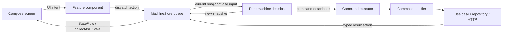

# How Weather uses Actron

[Back to the example](../README.md) · [Testing guide](../src/commonTest/README.md)

Weather has two screens and two machine definitions. Read the search feature first; the weather
feature applies the same integration to two parallel regions. Navigation is entirely Decompose's
responsibility. No third navigation machine is registered in Actron.

## Follow one input through the application



For search, the concrete chain is:

1. `CitySearchScreen` emits `CitySearchIntent.QueryChanged`.
2. `DefaultCitySearchComponent.onUiEvent` maps it to `CitySearchAction.ChangeQuery` and calls
   `store.dispatch`. It never assigns the feature state itself.
3. `MachineStore` processes the input sequentially against its current snapshot. The machine
   returns updated data, state transitions and descriptions of commands/timers to execute.
4. `citySearchHandler` runs `SearchCitiesUseCase`, which calls `CitySearchRepository`.
   It returns `Found` or `Failed`; the result goes back through the machine's input queue.
5. `collectAsUiState` collects snapshots for Compose. `toUiState` formats the context for display.

The root supplies `Dispatchers.Main` for this example. Suspending HTTP belongs in a handler;
reducers and guards must remain quick and deterministic. Configuring a different processor does
not make synchronous blocking work in a reducer appropriate. See the library's
[threading contract](../../../doc/guides/machine-mvi.md) for dispatcher and UI-collection details.

## Define a machine once

Start with [CitySearchMachine.kt](../../weather-app/src/commonMain/kotlin/actron/example/weather/feature/cities/presentation/CitySearchMachine.kt).

| Declaration | Meaning in Weather |
| --- | --- |
| `CitySearchState` | Immutable context: query, revision and a typed request state |
| `CitySearchAction` | User edits and typed operation results |
| `SearchCitiesCommand` | Data describing a search to run; contains no HTTP implementation |
| `typedStateMachine` | Connects the typed request state to the library's graph/runtime |
| `readState` / `writeState` | Select `context.phase` and copy its new value into the context |
| `state<T>` | Declares the transitions/handlers available in that state |
| `on<Action, Target>` | Optional guard/reducer plus construction of the target state |
| `after<Target>` | A timer owned by this state's current activation |
| `onEnter { command(...) }` | Request work when entering the state; execute it outside the decision |

`phase` holds the state value. There is no second handwritten `StateId` field to synchronize.
The DSL derives graph nodes from state declarations. `RequestState.Success` carries results,
`Error` carries an error message; loading and error booleans are not independently stored.
`MachineSnapshot` adds runtime configuration, revision and command/timer identities around the
context. The context's search `revision` identifies the query generation; it is distinct from
that runtime snapshot revision.

`DefinitionId` identifies a logical machine across its instances. `DefinitionVersion` is an
explicit compatibility contract for saved state/recordings. Bump it for incompatible behavioral
or data changes, including changes that do not alter the graph's visible structure. Region and
lane names are structural identifiers, not string keys for guards or effects.

### Search, cancellation and late answers

```text
Idle → ChangeQuery("Москва") → Debouncing → after 350 ms → Loading
Loading → ChangeQuery("Казань") → Debouncing → after 350 ms → Loading
```

The second edit updates the query/revision and exits the old `Loading` activation. Its command
and timeout are cancelled immediately, before the next debounce expires. Further edits restart
the debounce. Clearing enters `Idle`, with no pending search and no displayed results.

The new `Loading` entry creates a new command. The named lane uses `ConcurrencyPolicy.Latest`;
state-activation ownership also cancels work when the state exits. Timeout enters `TimedOut`.
Cancellation propagates through the command handler to the suspending repository/HTTP call;
`commandHandler` rethrows cancellation instead of converting it into `Failed`.

Stale-command identity checks and the `Found`/`Failed` revision guards are an additional defense
for already queued results or callbacks outside normal command delivery. A test that deliberately
injects an old result does not mean Weather intentionally leaves obsolete requests running.

### Parallel weather

[CityWeatherMachine.kt](../../weather-app/src/commonMain/kotlin/actron/example/weather/feature/weather/presentation/CityWeatherMachine.kt)
uses `parallelStateMachine`. `Current` selects `context.current`; `Hourly` selects `context.hourly`.
Each region declares its own Idle/Loading/Success/Error/TimedOut states, command and timeout.
The region writers copy only their own field, preserving the other region.

`Refresh` is handled by both regions in one machine decision. `RetryForecast` is declared only
in `Hourly`. HTTP results can arrive in either order; the machine still decides inputs one at a
time. Parallel regions represent concurrently active behavior, not concurrent writes to state.

## Components and lifetime

[WeatherRootComponent.kt](../../weather-app/src/commonMain/kotlin/actron/example/weather/app/WeatherRootComponent.kt)
creates the Decompose stack and feature factories. Selection/back events travel through the
example's `ParentBridge`/`BridgeEndpoint` to the root; they are not Actron actions controlling
navigation. `BaseComponent.Render()` and `StackComponent` render the active child.

[MachineInstance.kt](../../weather-app/src/commonMain/kotlin/actron/example/weather/core/component/MachineInstance.kt)
is the host adapter. It creates a `MachineStore` with its handler, scope, clock and observer, or
uses `resumeMachineStore` with an existing checkpoint. Essenty's `InstanceKeeper` retains it
across host recreation. Destruction closes the store and cancels its scope. The search child
stays on the back stack while weather is open; popping weather destroys that weather executor.
A restored weather component does not dispatch a fresh `Refresh` over the restored state.

## Recording, preview and restoration

The shared `weather-app` artifact initializes `WeatherSession`, which tracks current checkpoints
without recording a timeline, requesting explanations or serializing before/after fields.
`DefaultWeatherRootComponent` is the production entry point. The optional `weather-example`
artifact supplies `WeatherHistory` and `DebugWeatherRootComponent`. Android depends on it only
through `debugImplementation`; release uses `src/release` wiring and excludes the debugger.
See [startup configuration](../README.md#debug-and-release-initialization).


These are different representations with different capabilities:

| Representation | Contains | Used for |
| --- | --- | --- |
| `MachineSnapshot<C>` | Context and runtime configuration/identities | Current state and pure decisions |
| `ExecutorCheckpoint<C, CMD>` | Snapshot plus work/timing needed by the executor | Restarting pending operations |
| `WeatherFrame` | Search/weather checkpoints, route and coverage | Live history preview and continuation |
| `WeatherRecordingFrame` | Display data, active nodes and coverage | Imported view-only history |

[WeatherHistory.kt](../src/commonMain/kotlin/actron/example/weather/core/debug/WeatherHistory.kt)
attaches `DecisionTraceObserver` before the store starts. `BoundedMachineRecorder` retains the
machine trace; `HistoryTimeline` combines instances into a session-wide limit (500 by default,
set by `HistoryConfiguration` at startup).
The host supplies field projections and a `WeatherFrame`; Actron does not interpret its route.

Selecting a history entry renders its saved data without running commands. Continuing from a
resumable live entry calls the root's `continueFrom`: it replaces the Decompose children and
recreates executors from their checkpoints. Pending read requests restart; completed reads stay
completed; timers retain their remaining delay. This does not restore a suspended call stack or
guarantee exactly-once external side effects. Later history is removed after successful continuation.

[WeatherSavedState.kt](../../weather-app/src/commonMain/kotlin/actron/example/weather/core/session/WeatherSavedState.kt)
declares `checkpointGroup` with one search checkpoint and zero or one weather checkpoints.
`machinePersistence` validates/serializes each machine. The host maps those checkpoints into its
frame and registers the encoded result with Essenty `StateKeeper`; Android supplies the saved
instance-state transport. Only the latest resumable frame is saved, not the debug timeline.

[WeatherRecording.kt](../src/commonMain/kotlin/actron/example/weather/core/debug/WeatherRecording.kt)
uses `HistoryRecordingCodec` with the display schema and both graph definitions. Import checks
schema, machine versions and graph compatibility before displaying data. `HistoryRecordingPanel`
has no continuation path. Platform `HistoryFiles` adapters open/save bytes; the library has no
Android or Decompose dependency. File import never creates a feature component or HTTP command.

## Which Actron modules are involved?

| Module | Role here |
| --- | --- |
| `actron-statechart` | Machine DSL, decisions, queued Store, commands and timers |
| `actron-compose` | UI-safe collection of store snapshots |
| `actron-timetravel` | Recording, bounded history, checkpoint persistence and codecs |
| `actron-timetravel-compose` | Reusable history/graph inspector and resizing |
| `actron-statechart-test` | Scripted executor tests, pure graph exploration and coverage |
| `actron-timetravel-test` | Optional test-trace export to view-only recordings |

Weather intentionally demonstrates debug tooling on every target. In a production app, isolate
debug modules in debug/test dependencies. The reusable library owns machine behavior; the host
owns navigation, lifecycle adapters, display projections and platform file access.
